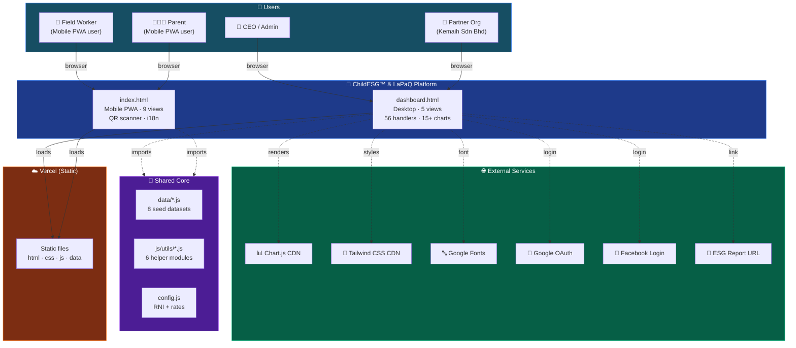
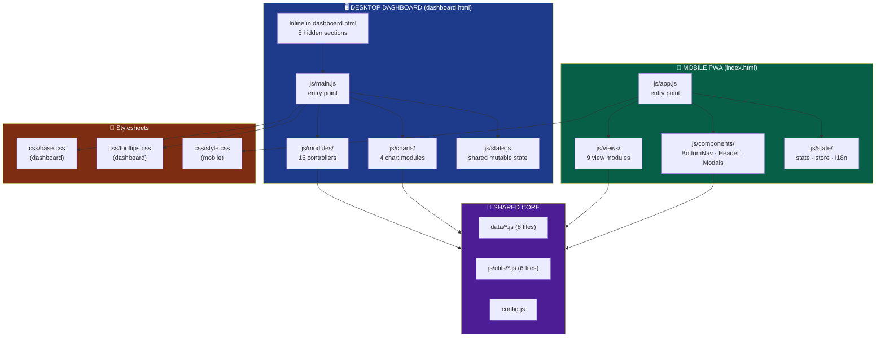
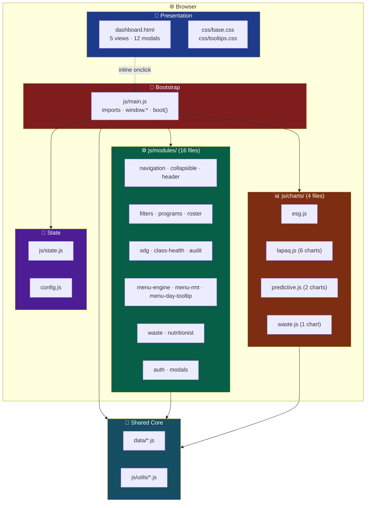
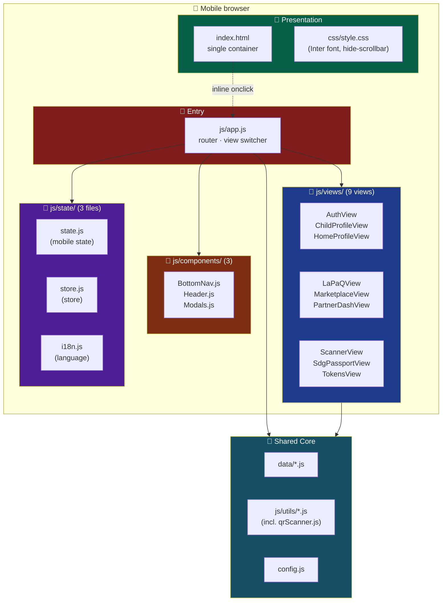
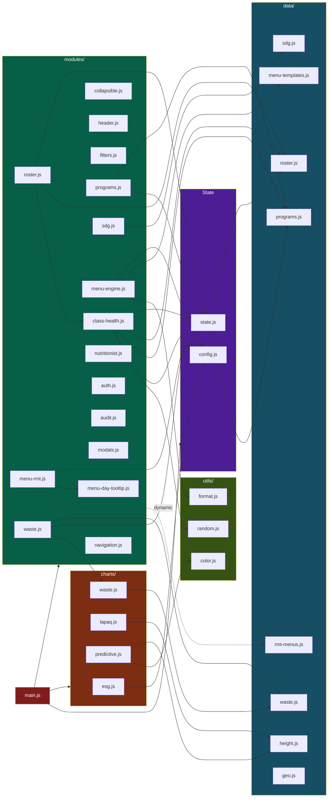
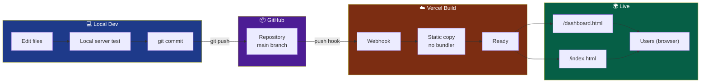
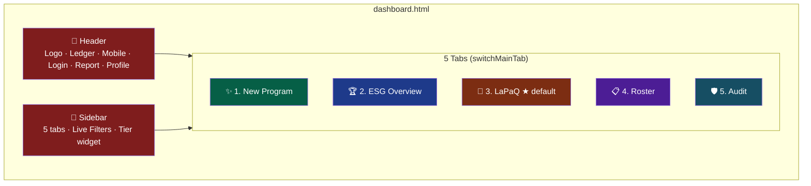

# ChildESG™ & LaPaQ Platform

A dual-entry governance platform for child-focused ESG & nutrition partners — a **desktop dashboard** for partner orgs and a **mobile PWA** for field workers, sharing a common data + utility core.


**Live dashboard:** [childesg-lapaq-mobile-mockup.vercel.app/dashboard.html](https://childesg-lapaq-mobile-mockup.vercel.app/dashboard.html)
**Live mobile PWA:** [childesg-lapaq-mobile-mockup.vercel.app](https://childesg-lapaq-mobile-mockup.vercel.app)

---

## Table of Contents

- [Executive Summary](#executive-summary)
- [Quick Start](#quick-start)
- [Entry Points](#entry-points)
- [Visual Architecture](#visual-architecture)
  - [1. System Context](#1-system-context--two-entry-points-shared-core)
  - [2. App Topology](#2-app-topology--two-apps-shared-core)
  - [3. Dashboard Container](#3-dashboard-container--desktop-app)
  - [4. Mobile PWA Container](#4-mobile-pwa-container--mobile-app)
  - [5. Module Dependency Graph](#5-module-dependency-graph--dashboard)
  - [6. Deployment Pipeline](#6-deployment-pipeline--edit-to-live)
  - [7. Dashboard Screen Map](#7-dashboard-screen-map--5-tabs)
- [The Dashboard](#the-dashboard-desktop)
- [The Mobile PWA](#the-mobile-pwa)
- [The Shared Core](#the-shared-core)
- [Data Model](#data-model)
- [External Integrations](#external-integrations)
- [Known Technical Debt](#known-technical-debt)
- [Recommended Target Architecture](#recommended-target-architecture)
- [Conventions & Rules of Thumb](#conventions--rules-of-thumb)
- [What To Fix First](#what-to-fix-first)
- [Quick Verification](#quick-verification-7-click-smoke-test)
- [License](#license)

---

## Executive Summary

**ChildESG™ & LaPaQ** is a governance platform for partners running child-focused ESG and nutrition programs. It has **two applications** deployed together:

| App | Entry | Users | Purpose |
|---|---|---|---|
| **Desktop Dashboard** | `dashboard.html` | Partners, CEOs, Admins | ESG reporting · WHO nutrition analytics · SDG tracking · Roster · Audit |
| **Mobile PWA** | `index.html` | Field workers, Nutritionists, Parents | QR scanning · Child profiles · LaPaQ tracking · SDG passport · Tokens |

Both apps **share a common core**: `data/*.js` seed data, `js/utils/*` helper functions, and `config.js` constants. They have **separate state layers** and **separate entry points** (`js/main.js` for dashboard, `js/app.js` for mobile).

**Current state:** Frontend-only prototype. All data is mock seed in `data/*.js`. No backend, no DB, no auth server.

**Architecture style:** Vanilla ES modules + Tailwind CDN + Chart.js CDN. No bundler, no framework, no build step.

**Numbers:** 2 apps · 5 dashboard views + 9 mobile views · 56 wired dashboard handlers · 15+ charts · 40+ ES modules · 220 mock participants · 20 RMT menus · 7 UN SDGs.

---

## Quick Start

```bash
git clone <repo-url>
cd <repo>
# no build step, no npm install
python3 -m http.server 8000
# or: npx serve .
```

- **Desktop dashboard:** `http://localhost:8000/dashboard.html`
- **Mobile PWA:** `http://localhost:8000/` (or `/index.html`)

**Requirements:** Any modern browser. Node.js not required to run — only to serve the folder over HTTP (ES modules fail on `file://` due to CORS).

**Deploy:** Push to `main`. Vercel auto-deploys (no build step). ~30–60 s to live.

---

## Entry Points

| URL | Serves | Purpose |
|---|---|---|
| `/` | `index.html` | Mobile PWA (default landing) |
| `/dashboard.html` | `dashboard.html` | Desktop governance dashboard |

The dashboard header has a **"📱 Mobile PWA"** button that links to `/index.html`. The mobile app has no explicit link back to the dashboard (mobile users typically don't need it).

⚠️ **If `index.htm` (missing `l`) is deployed instead of `index.html`, the bare domain will 404.** Verify this before announcing the URL to partners.

---

## Visual Architecture

Seven complementary views. Mermaid renders natively on GitHub, GitLab, Notion, Obsidian.

---

### 1. System Context — *Two entry points, shared core*



**Reading it:** Two apps (desktop + mobile) sit on Vercel, both serving from the same static bundle. They share `data/`, `js/utils/`, and `config.js`. Charts only load in the dashboard.

---

### 2. App Topology — *Two apps, shared core*



**Reading it:** Each app has its own entry point (`main.js` vs `app.js`), views, state, and stylesheet. Both pull from the shared `data/`, `js/utils/`, and `config.js`. The mobile app has **9 view modules** that swap a single DOM container, unlike the dashboard which has all 5 views inline in HTML.

---

### 3. Dashboard Container — *Desktop app*



**Reading it:** `js/main.js` is the sole hub. It imports from all layers and bridges 56 functions to `window.*` so inline HTML `onclick=` handlers work.

---

### 4. Mobile PWA Container — *Mobile app*



**Reading it:** `js/app.js` is the mobile entry point. Unlike the dashboard (5 views inline in HTML), the mobile app has 9 view modules that render into a single container. `js/state/` has its own `store.js` and `i18n.js` for mobile-specific concerns.

---

### 5. Module Dependency Graph — *Dashboard*



**Reading it:** Dashboard-only graph. `data/geo.js` is the map data used by `main.js` for state tooltips. `menu-rmt.js` uses **dynamic import** for `data/rmt-menus.js`. Cross-module imports are minimal: `roster → class-health`, `waste → charts/waste`.

---

### 6. Deployment Pipeline — *Edit to live*



**Reading it:** No build step. Vercel copies files as-is. Both apps deploy from the same commit. **Vercel is Linux (case-sensitive)** — imports must match filename case exactly.

---

### 7. Dashboard Screen Map — *5 tabs*



**Reading it:** Five sections toggled by `switchMainTab()`. No router, no URL change, no back button.

---

## The Dashboard (Desktop)

**Entry:** `dashboard.html` + `js/main.js`

### Views

| Tab | Content |
|---|---|
| **✨ New Program** | Program grid · filter · create modal · history |
| **🏆 ESG Overview** | 5 KPI cards · 40+ criteria methodology · 3-pillar breakdown · 7 SDG matrix · breakdown modal |
| **🥗 LaPaQ** (default) | State hub selector · 5 WHO charts · interactive map · state analysis · heatmap · growth trajectory + RNI radar · nutrient adequacy (11 rows) · predictive health risk (2 charts) |
| **📋 Roster** | 11 class attendance cards · 220-row participant table with pagination · verify/approve actions |
| **🛡️ Audit** | SHA-256 ledger log stream |

### Key Files

| File | Purpose |
|---|---|
| `js/main.js` | Entry, imports + 56 `window.*` bridge + boot order |
| `js/state.js` | Shared mutable state (dashboard only) |
| `js/modules/*.js` | 16 controllers (one per feature) |
| `js/charts/*.js` | 4 chart configs |
| `css/base.css` | Scrollbar, collapsible, nutrient rows, map hover |
| `css/tooltips.css` | Tooltip panels, RMT cards |

---

## The Mobile PWA

**Entry:** `index.html` + `js/app.js`

### Views (9)

| View | Purpose |
|---|---|
| `AuthView` | Login / Register |
| `HomeProfileView` | Home dashboard / profile summary |
| `ChildProfileView` | Per-child detail · growth charts · vaccine history |
| `LaPaQView` | Daily nutrition logging · RNI tracking |
| `MarketplaceView` | Rewards catalog · token redemption |
| `PartnerDashView` | Partner-specific mobile dashboard |
| `ScannerView` | QR scanner (child ID / token / attendance) |
| `SdgPassportView` | SDG evidence collection · gamified badges |
| `TokensView` | Token balance · transaction history |

### Components (3)

- `BottomNav.js` — primary navigation bar
- `Header.js` — top app bar
- `Modals.js` — shared mobile modals

### Mobile State (`js/state/`)

- `state.js` — mobile app's own state object
- `store.js` — mobile store (subscribe/notify pattern)
- `i18n.js` — multi-language strings

### Mobile Utilities

- `js/utils/qrScanner.js` — QR code scanning (camera + decode)
- `js/utils/dom.js` — DOM helpers for mobile
- `js/utils/helpers.js` — generic helpers

### Stylesheet

- `css/style.css` — Inter font, hide-scrollbar (opposite of dashboard's `custom-scrollbar`)

---

## The Shared Core

Both apps import from these.

| Category | Files | Purpose |
|---|---|---|
| **Data** | `data/roster.js` (220) · `programs.js` (10) · `sdg.js` (7) · `height.js` (WHO) · `waste.js` (7-day) · `menu-templates.js` (4) · `rmt-menus.js` (20) · `geo.js` (4 states) | Static seed data |
| **Utils** | `js/utils/color.js` · `format.js` · `random.js` · `dom.js` · `helpers.js` · `qrScanner.js` | Pure functions + browser APIs |
| **Constants** | `config.js` | `RNI_REFERENCE`, `WASTE_COST_PER_KG`, `SELANGOR_*_RATE` |

---

## Data Model

All data is **static seed** — no persistence layer, no DB.

| Entity | File | Count | Shape |
|---|---|---|---|
| Participant | `data/roster.js` | 220 | `{ id, name, token, course, date, org, attendance, rating, verified, tokensApproved }` |
| Program | `data/programs.js` | 10 | `{ id, title, icon, status, desc, cohort, sdg, date, location, participants }` |
| SDG Goal | `data/sdg.js` | 7 | `{ number, title, icon, theme, description, metrics[], subTargets[], programs[] }` |
| Height trajectory | `data/height.js` | 2 | `{ male, female }` — `labels[10], whoMedian[10], currentDiet[10], intervention[10]` |
| Waste log | `data/waste.js` | 7 days | `{ date, platesServed, leftovers, diverted }` |
| Menu template | `data/menu-templates.js` | 4 | `{ label, emoji, name, day, ingredients[], nutrients{11} }` |
| RMT menu | `data/rmt-menus.js` | 20 | `{ id, name, note, nutrients{11} }` + derived `rmtAverages` |
| Geo state | `data/geo.js` | 4 | `{ name, title, coursesCount, paxCount, badge, stuntingDetail, obesityDetail, calcium, vitc }` |

**Reference constants** (`config.js`):
- `RNI_REFERENCE` — 11 nutrients with reference daily values
- `WASTE_COST_PER_KG = 8.50`
- `SELANGOR_STUNTING_RATE = 0.133`, `SELANGOR_OBESITY_RATE = 0.210`

---

## External Integrations

| Service | Used by | Status |
|---|---|---|
| **Chart.js** (CDN) | Dashboard | ✅ Working |
| **Tailwind CSS** (CDN) | Both | ⚠️ Working (prod warning) |
| **Google Fonts** | Both | ✅ Working |
| **Google Identity Services** | Dashboard | ⚠️ Placeholder client ID |
| **Facebook Login** | Dashboard | ⚠️ Placeholder app ID + malformed SVG |
| **QR Scanner** (browser API) | Mobile PWA | ✅ Working |
| **Vercel** | Both | ✅ Working |
| **External ESG report URL** | Dashboard | ✅ External |

---

## Known Technical Debt

| Debt | Impact | Fix |
|---|---|---|
| `index.htm` (missing `l`) if truly deployed | Bare URL 404s | Rename to `index.html` |
| Tailwind CDN | 200 KB parse overhead, prod warning | Migrate to PostCSS build |
| No bundler | No tree-shaking, slow cold load, manual `../` depth errors | Add Vite |
| Inline `onclick=` handlers | Forces 56 `window.*` assignments, kills testability | Event delegation / `addEventListener` |
| Shared mutable arrays | Any module can mutate, no reactivity | Zustand-like store |
| No router (dashboard) | No deep linking | `history.pushState` + hash routing |
| No persistence | Refresh loses all changes | Backend + DB or localStorage |
| `menu-day-tooltip.js` stubbed | 4 no-op functions remain | Delete entirely |
| `data/menu-days.js` orphaned | Unused file may still exist | Delete |
| Malformed Facebook SVG path | Console error on every load | Fix `<path d>` |
| No favicon | 404 on every load | Add `favicon.ico` |
| No tests | Silent regressions | Vitest + Playwright |
| 15+ charts init on load | Slow first paint | Lazy init on tab visible |
| Chart resize sweep is a hack | Fragile | `IntersectionObserver` |

---

## Recommended Target Architecture

### Path A — Prototype / Demo

Current architecture is fine. Fix the debt table above and stop.

### Path B — Production Product

**Phase 1 — Stabilization (1–2 weeks)**
1. Add **Vite** — bundling, tree-shaking, path aliases, TypeScript
2. Tailwind CDN → PostCSS build
3. Fix `index.htm` typo
4. Delete stub code + orphaned files
5. Fix FB SVG + add favicon

**Phase 2 — Modularization (2–3 weeks)**
1. Replace inline `onclick=` with `data-action` + one delegated listener
2. Delete the 56 `window.*` assignments
3. **Unify state** — one store shared by both apps (currently separate)
4. Make `data/*.js` immutable after load
5. Add Vitest + Playwright smoke test

**Phase 3 — Backend (4–6 weeks)**
1. Add backend: **Next.js API routes** or **Cloudflare Workers**
2. Persist to **Postgres** (Neon, Supabase)
3. Move `data/*.js` → DB tables
4. Real OAuth with proper redirect URIs
5. Session or JWT auth
6. Replace `alert()` with toasts

**Phase 4 — Product Scale**
1. Multi-tenant (Kemaih + next partner)
2. Real RLS on data
3. Audit log write path (currently read-only mock)
4. Token minting ledger integration
5. Scheduled ESG report generation

---

## Conventions & Rules of Thumb

### Path Depth Rule

| File location | To reach project root | To reach `/data/` |
|---|---|---|
| `js/state.js` | `../` | `../data/` |
| `js/modules/*.js` | `../../` | `../../data/` |
| `js/charts/*.js` | `../../` | `../../data/` |
| `js/utils/*.js` | `../../` (if importing data) | — |
| `js/views/*.js` | `../../` | `../../data/` |
| `js/state/*.js` | `../../` | `../../data/` |

**If you ever get a 404, 99% of the time it's one `../` short.**

### Dynamic Imports

Files with `await import(...)` bypass static-import checks. `menu-rmt.js` uses this for `data/rmt-menus.js` — the only runtime-only dependency. **Manually verify** any file using dynamic import.

### Case Sensitivity

Vercel runs Linux. `Roster.js` ≠ `roster.js`. All imports must be lowercase.

### Chart Lifecycle

Charts must be re-`resize()`'d when their containing panel becomes visible (`switchMainTab`, collapsible open). `resizeAllCharts()` in `main.js` handles this. Any new chart must respect this pattern.

### Boot Order (`main.js`)

1. Document-level listeners — first
2. Charts — second
3. UI renders — third
4. Async loads — fourth
5. `resizeAllCharts()` — sweep
6. Diagnostic — verify all 56 handlers wired

### Two-App Boundary

When adding a file, decide **first**:
- **Shared** (`data/`, `js/utils/`, `config.js`) — used by both apps
- **Dashboard-only** (`js/modules/`, `js/charts/`, `js/state.js`) — desktop only
- **Mobile-only** (`js/views/`, `js/components/`, `js/state/`) — mobile only

Mixing these creates coupling that's hard to untangle later.

---

## What To Fix First

**If you have 1 hour:**
1. **Verify `index.htm` vs `index.html`** — rename if it's missing the `l`
2. **Delete 2 orphaned files** — `data/menu-days.js` (unused), stub `menu-day-tooltip.js` if `getMenuDayStatus` is inlined elsewhere
3. **Fix FB SVG** — line 1282 in `dashboard.html`
4. **Add `favicon.ico`**
5. **Tag working state** — `git tag v1.0-working && git push --tags`

**If you have 1 day:**
6. **Add Vite** — Phase 1 above
7. **Migrate Tailwind to PostCSS** — kills warning, drops ~200 KB

---

## Quick Verification (7-Click Smoke Test)

After deploy, verify the dashboard works:

| # | Action | Expected |
|---|---|---|
| 1 | Click each sidebar tab | Views switch cleanly |
| 2 | LaPaQ → click **Selangor** | Pies + bar update, badge changes |
| 3 | Hover map pins / SVG paths | Tooltip appears |
| 4 | Hover **Critical Gaps** KPI card | Table rows dim/highlight |
| 5 | Click **♂ Male** → **♀ Female** | Height chart redraws |
| 6 | Click **Menu & Dietary Analysis** | Modal + 20 RMT cards |
| 7 | ESG → click **Score: 82 / 100** | Breakdown modal opens |

**Expected console (after hard reload, `Ctrl+Shift+R` / `Cmd+Shift+R`):**

```
🚀 boot() running
[dashboard] ✓ all 56 inline handlers wired
✅ all charts initialized
```

**Only expected warnings** (all pre-existing, none affect functionality):
- `cdn.tailwindcss.com should not be used in production`
- `Error: <path> attribute d: Expected number` — Facebook SVG
- `favicon.ico 404`

### Mobile PWA Quick Check

| # | Action | Expected |
|---|---|---|
| 1 | Visit `/` (or `/index.html`) | Mobile PWA loads |
| 2 | Navigate between views (bottom nav) | All 9 views render |
| 3 | Open Scanner | Camera permission prompt |
| 4 | Switch language (if i18n active) | Strings update |

---

## License

Internal / proprietary — ChildESG™ · Kemaih Sdn Bhd. All rights reserved.

---

*Last updated: 2026-11-12 · v1.0-working*

---

### Notes on Assumptions (delete this section once verified)

This README was written from your folder listing on 2026-11-12. Verify these assumptions before sharing externally:

1. **`index.htm` vs `index.html`** — I've assumed it may be a typo. If `/` serves correctly on Vercel, it's `index.html`.
2. **CSS location** — I've assumed `css/` folder contains all 3 stylesheets. Adjust the folder tree if any are at root.
3. **`js/state.js` vs `js/state/state.js`** — I've assumed two separate files (dashboard vs mobile). If they're the same file, consolidate the docs.
4. **Mobile PWA deployment** — I've assumed both apps deploy together on the same Vercel project. Adjust if separate.
5. **Mobile view purposes** — the 9-view purposes in the Mobile PWA section are inferred from filenames. Adjust if any differ.
