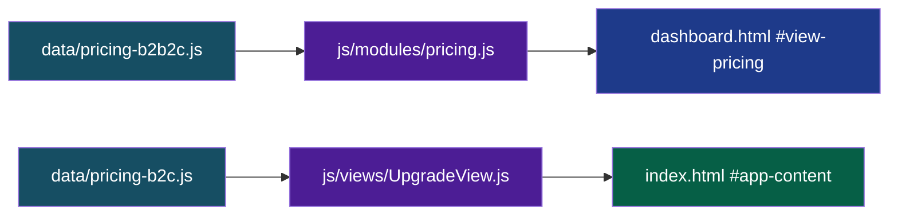
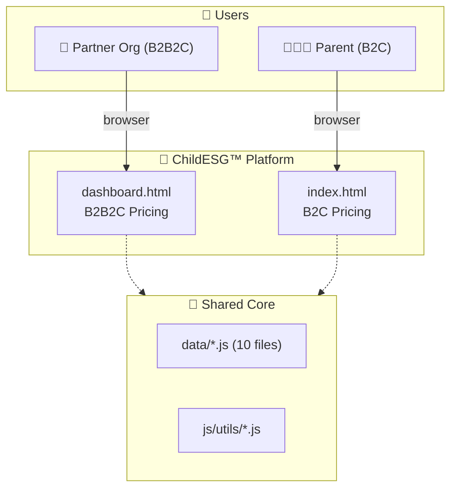
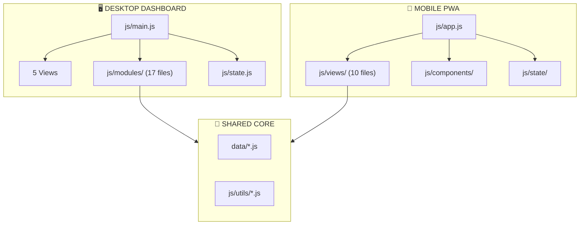

# ChildESG™ & LaPaQ Platform

A dual-entry governance and nutrition platform for child-focused ESG partners — a **desktop dashboard** for partner organizations (B2B2C) and a **mobile PWA** for parents (B2C), sharing a common data and utility core.


**Live Dashboard:** [childesg-lapaq-mobile-mockup.vercel.app/dashboard.html](https://childesg-lapaq-mobile-mockup.vercel.app/dashboard.html)
**Live Mobile PWA:** [childesg-lapaq-mobile-mockup.vercel.app](https://childesg-lapaq-mobile-mockup.vercel.app)

---

## Table of Contents

- [Executive Summary](#executive-summary)
- [Quick Start](#quick-start)
- [Entry Points](#entry-points)
- [Pricing Engine Architecture](#pricing-engine-architecture)
- [Visual Architecture](#visual-architecture)
- [Frontend Architecture](#frontend-architecture)
- [Data Model](#data-model)
- [External Integrations](#external-integrations)
- [Known Technical Debt](#known-technical-debt)
- [Recommended Target Architecture](#recommended-target-architecture)
- [Conventions & Rules of Thumb](#conventions--rules-of-thumb)
- [What To Fix First](#what-to-fix-first)
- [Quick Verification](#quick-verification)

---

## Executive Summary

**ChildESG™ & LaPaQ** is a governance platform for partners running child-focused ESG and nutrition programs. It has **two applications** deployed together:

| App | Entry | Users | Purpose |
|---|---|---|---|
| **Desktop Dashboard** | `dashboard.html` | Partners, CEOs, Admins | ESG reporting · WHO nutrition analytics · SDG tracking · Roster · Audit · **B2B2C Pricing** |
| **Mobile PWA** | `index.html` | Field workers, Parents | QR scanning · Child profiles · LaPaQ tracking · SDG passport · Tokens · **B2C Pricing** |

Both apps **share a common core**: `data/*.js` seed data, `js/utils/*` helper functions, and `config.js` constants. They have **separate state layers** and **separate entry points** (`js/main.js` for dashboard, `js/app.js` for mobile).

**Current state:** Frontend-only prototype. All data is mock seed in `data/*.js`. No backend, no real DB, and **no real payment processing** (pricing pages are interactive UI mockups).

**Architecture style:** Vanilla ES modules + Tailwind CDN + Chart.js CDN. No bundler, no framework, no build step.

**Numbers:** 2 apps · 5 dashboard views + 10 mobile views · 60+ dashboard handlers · 15+ charts · 50+ ES modules · 220 mock participants · 20 RMT menus · 7 UN SDGs · **2 pricing engines (3 tiers × 3 currencies × 3 terms)**.

---

## Quick Start

```bash
git clone <repo-url>
cd <repo>
# no build step, no npm install
python3 -m http.server 8000
# or: npx serve .
```

- **Desktop dashboard:** `http://localhost:8000/dashboard.html`
- **Mobile PWA:** `http://localhost:8000/` (or `/index.html`)

**Requirements:** Any modern browser. Node.js not required to run — only to serve the folder over HTTP (ES modules fail on `file://` due to CORS).

**Deploy:** Push to `main`. Vercel auto-deploys (no build step). ~30–60 s to live.

---

## Entry Points

| URL | Serves | Purpose |
|---|---|---|
| `/` | `index.html` | Mobile PWA (default landing) |
| `/dashboard.html` | `dashboard.html` | Desktop governance dashboard |

The dashboard header has a **"📱 Mobile PWA"** button that links to `/index.html`. 

---

## Pricing Engine Architecture

The platform features two distinct pricing engines:

1. **B2B2C (Institutional):** Displayed on the dashboard. Partners choose from **Standard**, **Chain**, or **Enterprise** tiers. Parents under these partners get premium features for free.
2. **B2C (Consumer):** Displayed on the mobile app. Parents choose from **Free**, **Plus**, or **Family** tiers.

Both engines support:
- **3 Currencies:** 🇲🇾 MYR, 🇺🇸 USD, 🇮🇩 IDR
- **3 Terms:** Monthly, Quarterly, Yearly
- **Dynamic Math:** Cards display the true monthly equivalent (e.g., `RM 50/yr` displays as `≈ RM 4.17/mo`).

### Data Flow


---

## Visual Architecture

### 1. System Context


### 2. App Topology


---

## Frontend Architecture

### Folder Structure

```
/
├── dashboard.html          ← Desktop entry
├── index.html              ← Mobile PWA entry
├── README.md               ← This file
├── config.js               ← Constants (RNI, Waste rates)
├── css/
│   ├── base.css            ← Dashboard styles
│   ├── tooltips.css        ← Dashboard tooltips
│   └── style.css           ← Mobile PWA styles
├── js/
│   ├── main.js             ← Dashboard router/boot
│   ├── app.js              ← Mobile router/boot
│   ├── state.js            ← Dashboard state
│   ├── charts/             ← 4 chart modules
│   │   ├── esg.js
│   │   ├── lapaq.js
│   │   ├── predictive.js
│   │   └── waste.js
│   ├── modules/            ← 17 dashboard controllers
│   │   ├── pricing.js      ← B2B2C pricing engine
│   │   ├── navigation.js
│   │   ├── filters.js
│   │   ├── roster.js
│   │   └── ...
│   ├── views/              ← 10 mobile views
│   │   ├── UpgradeView.js  ← B2C pricing engine
│   │   ├── AuthView.js
│   │   ├── HomeProfileView.js
│   │   ├── ChildProfileView.js
│   │   └── ...
│   ├── components/         ← 3 mobile components
│   │   ├── Header.js
│   │   ├── BottomNav.js
│   │   └── Modals.js
│   ├── state/              ← Mobile state (store, i18n)
│   │   ├── store.js
│   │   └── i18n.js
│   └── utils/              ← Shared helpers
│       ├── color.js
│       ├── format.js
│       ├── helpers.js
│       └── qrScanner.js
└── data/
    ├── roster.js           ← 220 participants
    ├── programs.js         ← 10 programs
    ├── sdg.js              ← 7 SDGs
    ├── height.js           ← WHO trajectories
    ├── waste.js            ← 7-day logs
    ├── menu-templates.js   ← 4 sample menus
    ├── rmt-menus.js        ← 20 MoE menus
    ├── geo.js              ← 4 state hubs
    ├── pricing-b2b2c.js    ← B2B2C tiers & currencies
    └── pricing-b2c.js      ← B2C tiers & currencies
```

---

## Data Model

All data is **static seed** — no persistence layer.

| Entity | File | Count | Shape |
|---|---|---|---|
| Participant | `data/roster.js` | 220 | `{ id, name, token, course, date, org, attendance, rating, verified }` |
| Program | `data/programs.js` | 10 | `{ id, title, icon, status, desc, cohort, sdg, date, location }` |
| SDG Goal | `data/sdg.js` | 7 | `{ number, title, icon, theme, metrics[], subTargets[], programs[] }` |
| Height trajectory | `data/height.js` | 2 | `{ male, female }` — WHO medians & projections |
| Waste log | `data/waste.js` | 7 days | `{ date, platesServed, leftovers, diverted }` |
| Menu template | `data/menu-templates.js` | 4 | `{ label, ingredients[], nutrients{11} }` |
| RMT menu | `data/rmt-menus.js` | 20 | `{ id, name, nutrients{11} }` |
| Geo state | `data/geo.js` | 4 | `{ name, title, coursesCount, paxCount, badge, stuntingDetail }` |
| **B2B2C Plan** | `data/pricing-b2b2c.js` | 3 | Standard, Chain, Enterprise (MYR/USD/IDR pricing) |
| **B2C Plan** | `data/pricing-b2c.js` | 3 | Free, Plus, Family (MYR/USD/IDR pricing) |

---

## External Integrations

| Service | Purpose | Status |
|---|---|---|
| **Chart.js** (CDN) | All 15+ charts | ✅ Working |
| **Tailwind CSS** (CDN) | All styling | ⚠️ Working (prod warning) |
| **Google Fonts** | Plus Jakarta Sans, Inter | ✅ Working |
| **QR Scanner** (Browser API) | Mobile PWA | ✅ Working |
| **Vercel** | Static hosting | ✅ Working |
| **Payment Gateway** | B2B & B2C checkout | ❌ **Mockup only** (requires Stripe/Billplz/Midtrans integration) |

---

## Known Technical Debt

| Debt | Impact | Fix |
|---|---|---|
| No backend / DB | Refresh loses all changes | Backend + DB (Postgres/Supabase) |
| **Mock pricing checkout** | Buttons trigger `alert()` instead of processing payment | Integrate Stripe (USD) / Billplz (MYR) / Midtrans (IDR) |
| Tailwind CDN | 200 KB overhead, prod warning | Migrate to PostCSS build |
| No bundler | Manual cache-busting (`?v=X`) needed | Add Vite or esbuild |
| Inline `onclick=` handlers | Forces 60+ `window.*` assignments | Event delegation / `addEventListener` |
| No router (dashboard) | No deep linking | `history.pushState` + hash routing |
| Malformed Facebook SVG path | Console error on every load | Fix `<path d="...">` in login modals |
| No favicon | 404 on every load | Add `favicon.ico` |

---

## Recommended Target Architecture

### Phase 1 — Stabilization (Completed ✅)
- Correct relative imports (`../../data/` vs `../data/`).
- Case-sensitive filenames for Vercel.
- Split huge files into ES modules.

### Phase 2 — Pricing UI (Completed ✅)
- Build B2B2C pricing mockup (Dashboard).
- Build B2C pricing mockup (Mobile PWA).
- Add multi-currency (MYR/USD/IDR) and multi-term (1M/3M/1Y) support.

### Phase 3 — Backend & Payments (Next Phase)
1. **Add Auth:** Real user accounts (parents & partners).
2. **Add DB:** Tables for `subscriptions`, `invoices`, `payments`.
3. **Payment Gateways:** 
   - **Stripe:** For global USD cards.
   - **Billplz:** For Malaysian FPX / MYR.
   - **Midtrans:** For Indonesian IDR.
4. **Webhooks:** Listen for `payment_succeeded` to unlock features.
5. **Token Ledger:** Move token balances from mock memory to the database.

### Phase 4 — Product Scale
1. Multi-tenant (onboard more partners).
2. Real RLS on data.
3. Scheduled ESG report generation.

---

## Conventions & Rules of Thumb

### Path Depth Rule
| File location | To reach project root | To reach `/data/` |
|---|---|---|
| `js/state.js` | `../` | `../data/` |
| `js/modules/*.js` | `../../` | `../../data/` |
| `js/charts/*.js` | `../../` | `../../data/` |
| `js/views/*.js` | `../../` | `../../data/` |

**If you ever get a 404, 99% of the time it's one `../` short.**

### Cache Busting
When debugging broken deployments on Vercel (where a file seemingly refuses to update), append a version query to your entry point imports in `index.html` and `dashboard.html`:
```html
<script type="module" src="js/main.js?v=2"></script>
```

### Case Sensitivity
Vercel runs Linux. `Roster.js` ≠ `roster.js`. All imports must be lowercase.

### Chart Lifecycle
Charts must be re-`resize()`'d when their containing panel becomes visible. Use `resizeAllCharts()` in `main.js`.

---

## Quick Verification (Smoke Test)

Once deployed, verify the app is functional:

### 1. Dashboard (B2B2C)
| # | Action | Expected |
|---|---|---|
| 1 | Click each sidebar tab | Views switch cleanly |
| 2 | **LaPaQ:** click **Selangor** | Pies + bar update |
| 3 | **Pricing:** click **🇺🇸 USD** | Prices switch to `$12 / $10.50 / $9` |
| 4 | **Pricing:** click **Yearly** | Monthly equiv updates (`≈ $1.00 /mo`) |

### 2. Mobile PWA (B2C)
| # | Action | Expected |
|---|---|---|
| 1 | Log in as Parent | Home profile loads |
| 2 | Click **⭐ Upgrade to Plus** | Pricing page loads |
| 3 | Click **🇮🇩 IDR** | Prices switch to `IDR 260,000` |
| 4 | Click **Choose Plus** | Mock checkout alert appears |

---

## License

Internal / proprietary — ChildESG™ · Kemaih Sdn Bhd. All rights reserved.

---

*Last updated: 2026-11-13 · v3.0-pricing*
```

